<div align="center">

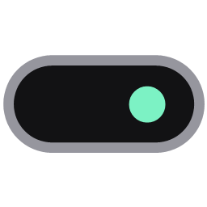

# TopNotch

### The Dynamic Island for Windows and macOS

A free, open-source notch at the top of your screen that shows what's playing with **word-by-word synced lyrics**, and gives you **music controls, a volume mixer, Bluetooth, clipboard history, a focus timer, system stats, a file shelf** and a one-click **file converter with AI background removal**.

<br />

<a href="https://github.com/ppiku4/topnotch/releases/latest"></a>
&nbsp;
<a href="https://github.com/ppiku4/topnotch/releases/latest"></a>

<br />

<a href="https://github.com/ppiku4/topnotch/releases/latest"></a>
<a href="https://github.com/ppiku4/topnotch/releases"></a>

<a href="LICENSE"></a>
<a href="https://github.com/ppiku4/topnotch/stargazers"></a>

<br /><br />

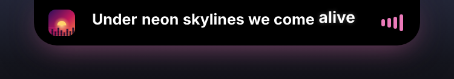

<br />

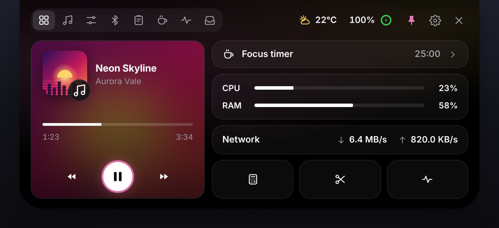

<sub>Screenshots show the real UI rendered with sample data.</sub>

<br />

**[Download](#-download)** · **[Features](#-features)** · **[Windows vs macOS](#-windows-vs-macos)** · **[FAQ](#-faq)** · **[Build from source](#-build-from-source)** · **[Privacy](#-privacy)**

</div>

---

## What is TopNotch?

**TopNotch is a free Dynamic Island app for Windows 10, Windows 11 and macOS (Apple Silicon).** It puts a small pill at the top of your screen, like the Dynamic Island on iPhone or the notch on a MacBook. The pill shows the song that's playing with live synced lyrics, or the day, time and weather when nothing plays. Hover it and it opens into a panel with music controls, a per-app volume mixer, Bluetooth devices, clipboard history, a Pomodoro focus timer, system stats and a drag-and-drop file shelf.

It also adds a **file wheel**: Alt+click (Option+click on Mac) any file to convert images, documents, spreadsheets, slides, video and audio, or to **remove an image background with on-device AI**, all without uploading anything.

It works with Spotify, Apple Music, YouTube in your browser, and any player that reports to the system's media controls.

---

## ⬇ Download

<table>
  <tr>
    <th align="left">Platform</th>
    <th align="left">File on the release page</th>
    <th align="left">Requirements</th>
  </tr>
  <tr>
    <td><b>Windows</b> installer (recommended)</td>
    <td><code>TopNotch Setup &lt;version&gt;.exe</code></td>
    <td rowspan="2">Windows 10 (1809) or later, x64.<br />Some effects (Dark glass blur) need Windows 11.</td>
  </tr>
  <tr>
    <td><b>Windows</b> portable (no install)</td>
    <td><code>TopNotch &lt;version&gt;.exe</code></td>
  </tr>
  <tr>
    <td><b>macOS</b></td>
    <td><code>TopNotch-&lt;version&gt;-arm64.dmg</code></td>
    <td>macOS 12 Monterey or later, Apple Silicon (M1 and newer).</td>
  </tr>
</table>

<p align="center">
  <a href="https://github.com/ppiku4/topnotch/releases/latest"><b>→ Get the latest release</b></a>
  &nbsp;·&nbsp;
  <a href="https://github.com/ppiku4/topnotch/releases">All releases</a>
</p>

<details>
<summary><b>Windows: first launch</b></summary>

<br />

Run the installer, or just open the portable `.exe`. If Windows SmartScreen says it protected your PC, click **More info → Run anyway**. TopNotch then appears at the top of your main screen and in the system tray.

On first run it offers to download the engines the file wheel needs (ffmpeg, LibreOffice and the background-removal model) and shows the progress. Copies already on your PC are used instead.

</details>

<details>
<summary><b>macOS: first launch</b></summary>

<br />

Open the `.dmg` and drag **TopNotch** to **Applications**. The app isn't signed with an Apple Developer ID, so the first launch needs one extra step: right-click TopNotch → **Open**, or after a blocked launch go to **System Settings → Privacy & Security → Open Anyway**.

macOS asks once for each of these, the first time a feature needs it:

- **Control Finder** (Automation): for the Option+click file wheel, to ask Finder which file you clicked.
- **Bluetooth**: for the Bluetooth tab and battery levels.
- **Desktop, Documents and Downloads** (and external drives): the first time you convert a file there, so TopNotch can read it and save the converted copy next to it.

</details>

---

## ✨ Features

| | |
| --- | --- |
| 🎵 [**Live pill & synced lyrics**](#-live-pill-that-fits-its-content) | 🎛 [**Volume, brightness & mixer**](#-volume-brightness--per-app-mixer) |
| 🏠 [**Dashboard**](#-dashboard) | 🔔 [**Live activities**](#-live-activities) |
| 🎤 [**Music tab with scrolling lyrics**](#-music-tab-apple-music-style-lyrics) | 🌀 [**File wheel converter**](#-file-wheel-convert-any-file-in-one-click) |
| 🎧 [**Bluetooth devices**](#-bluetooth-devices--battery) | ✂️ [**AI background remover & image editor**](#-ai-background-remover--quick-image-editor) |
| 📋 [**Clipboard history**](#-clipboard-history) | ⏱ [**Focus timer & Pomodoro**](#-focus-timer--pomodoro) |
| 📊 [**System stats**](#-system-stats-cpu-gpu-ram-network-temperatures) | 🗂 [**File shelf**](#-file-shelf) |
| 🎨 [**Settings & themes**](#-settings--customisation) | 🔒 [**Private by design**](#-privacy) |

### 🎵 Live pill that fits its content

<p align="center">
  
  <br />
  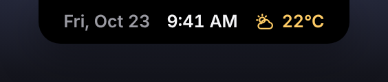
</p>

The pill is always there but never in the way. It resizes to whatever it's showing:

- **While music plays:** album art, the current lyric line filling word by word as it's sung, and audio bars in the song's colours.
- **When nothing plays:** the day, time and weather.
- **On demand:** camera or microphone in use, a running timer, or a call in progress.

Scroll over the pill to change volume, Shift+scroll for brightness. Drag it to any screen edge, or let it hide behind maximised windows.

### 🏠 Dashboard

<p align="center"></p>

Hover the pill (or click, if you prefer) to open the panel. The **Dashboard** shows everything at a glance: what's playing with artwork, a seek bar and play/pause/next/previous, a focus timer shortcut, live CPU and RAM meters, download and upload speed, and one-click Calculator, Snipping Tool and Task Manager. The accent colour comes from the album art.

### 🎤 Music tab: Apple Music-style lyrics

<p align="center">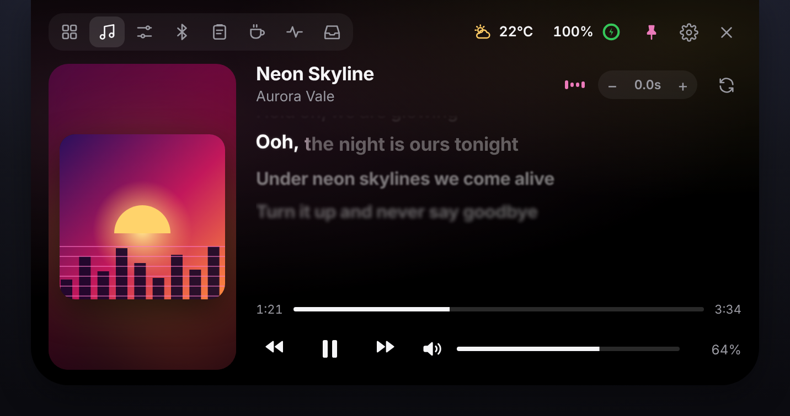</p>

Synced lyrics come from [lrclib.net](https://lrclib.net/), matched to the exact song and version that's playing, with real per-word timing from NetEase Cloud Music when it's available.

- Words fill as they're sung; held notes swell and glow.
- The list scrolls with the song. **Click any line to jump there.**
- Lyrics early or late? Nudge them with **− / +** (saved per song), or hit **Re-sync**.
- Works with Spotify, Apple Music, browsers (YouTube, SoundCloud…) and any app that shows up in the system's media controls.

### 🎛 Volume, brightness & per-app mixer

<p align="center">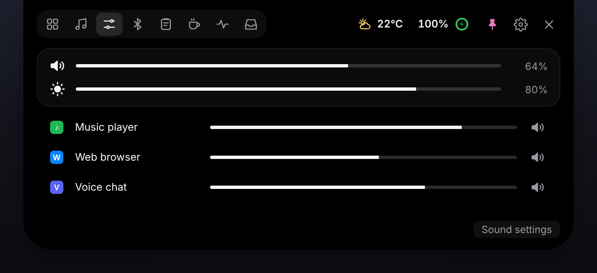</p>

Master volume and screen brightness, plus a **volume slider for every app that's playing sound**. Brightness works on laptop screens and on external monitors over DDC/CI. Change the volume with your keyboard and a clean pop-up appears in the notch instead.

### 🔔 Live activities

<p align="center">
  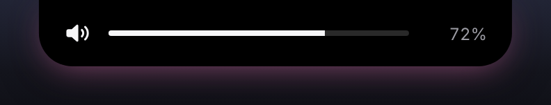
  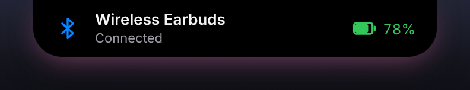
  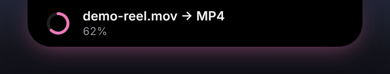
</p>

Short, animated alerts that take over the pill for a moment, like iOS Live Activities: volume and brightness changes, Bluetooth devices connecting (with battery), charging, low battery, timer finished, camera or mic in use (and which app), and file conversion progress with a **Show** button when it's done.

### 🎧 Bluetooth devices & battery

<p align="center">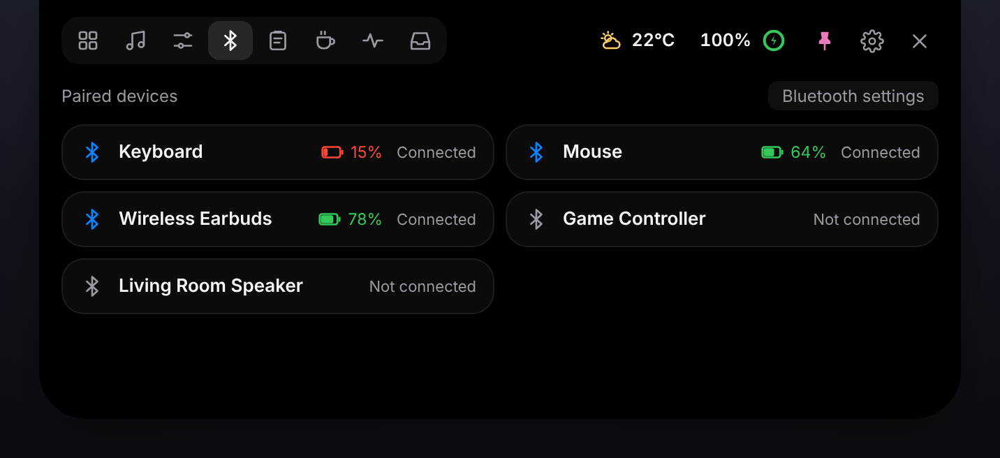</p>

Every paired device, whether it's connected, and its **battery level** (earbuds, keyboards, mice, controllers). Low batteries turn red.

### 📋 Clipboard history

<p align="center">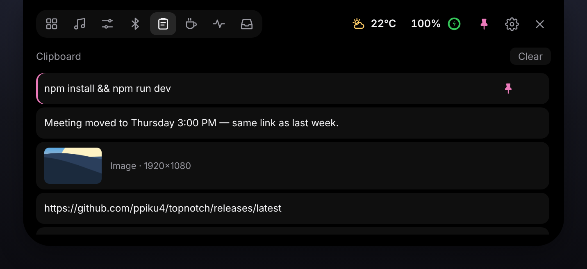</p>

Everything you copy, text and images, one click away. Click an entry to copy it again, **pin** the ones you reuse, delete the rest. You can turn it off in Settings.

### ⏱ Focus timer & Pomodoro

<p align="center">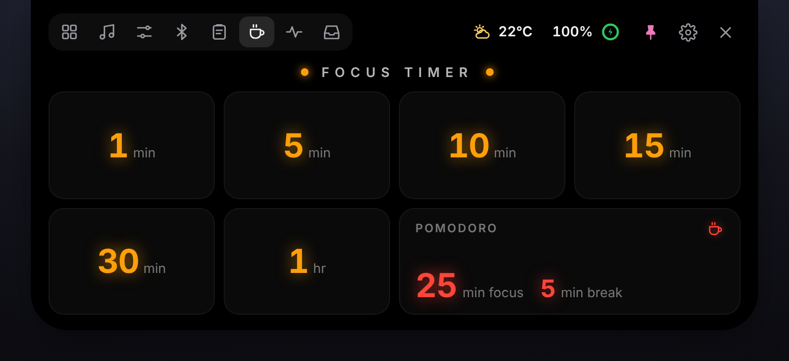</p>

One-tap timers from 1 minute to 1 hour, or a **Pomodoro** cycle (25 minutes focus, 5 minutes break) that loops on its own. The countdown sits in the pill while you work, and a soft chime and a notification tell you when time's up.

### 📊 System stats: CPU, GPU, RAM, network, temperatures

<p align="center">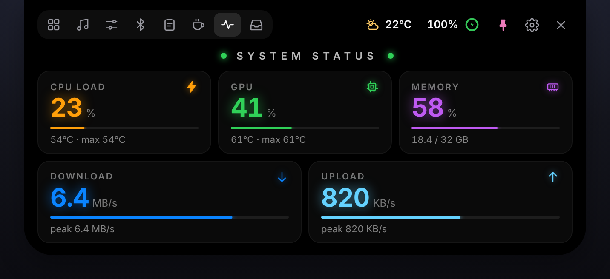</p>

Live **CPU load, GPU usage, memory, download and upload speed**, with temperatures and peaks. GPU usage and temperature (NVIDIA) work out of the box. For CPU temperature on Windows, see [CPU temperature](#cpu-temperature-optional-windows).

### 🗂 File shelf

<p align="center">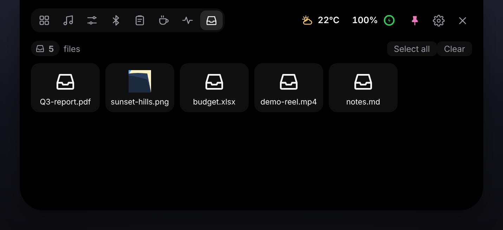</p>

Drag files to the top of the screen and the notch opens to catch them. Park files there while you switch windows, then drag them out into an email, chat or folder. Select several (click, Ctrl+click, Shift+click) to drag them out together, or grab the whole stack at once.

### 🌀 File wheel: convert any file in one click

<p align="center">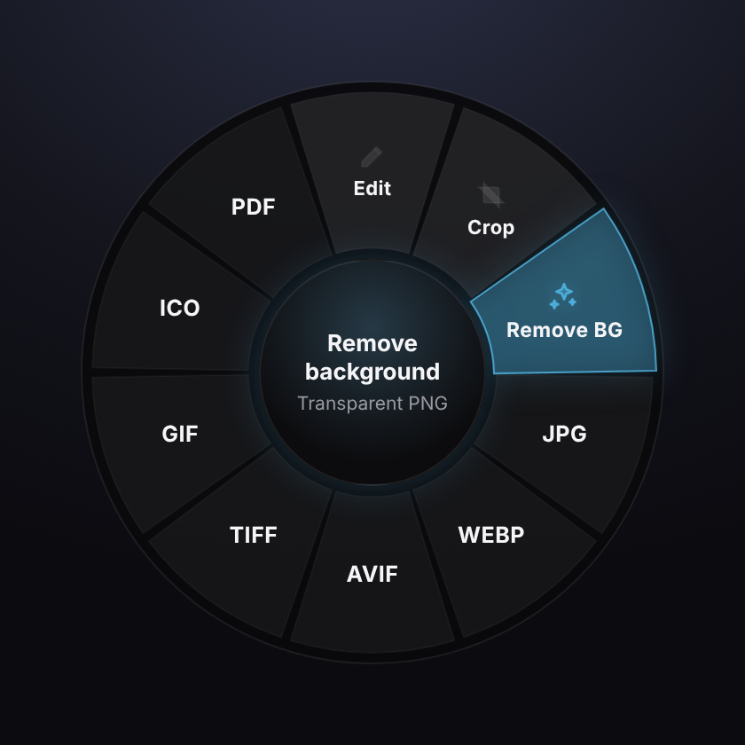</p>

**Alt+click** a file in File Explorer or on the desktop (**Option+click** in Finder on Mac) and a radial menu opens around it. Pick a format and a converted copy is saved next to the original. Your original is never overwritten, and progress and a **Show** button appear in the notch.

| File type | Converts to |
| --- | --- |
| **Images:** PNG, JPG, WEBP, TIFF, AVIF, GIF, BMP, ICO, PSD, SVG (input) | Any of those formats, plus **Remove BG**, **Edit** and **Crop** |
| **Documents:** TXT, MD, HTML, DOCX, PDF, DOC, ODT, RTF, WPD, WPS | PDF, DOCX, ODT, RTF, DOC, HTML, TXT, MD |
| **Spreadsheets:** XLSX, XLS, XLSM, XLSB, ODS, CSV, TSV | XLSX, PDF, CSV, ODS, XLS, HTML |
| **Presentations:** PPTX, PPT, PPSX, POTX, ODP, Keynote | PPTX, PDF, ODP, PPT |
| **Drawings:** VSDX, VSD, ODG, Publisher | PDF, PNG, SVG, ODG |
| **Video** | MP4, MKV, WEBM, MOV, GIF, or MP3 / WAV / M4A audio |
| **Audio:** MP3, WAV, FLAC, M4A, OGG, OPUS | Any of those formats |

Text, Markdown, HTML, DOCX and PDF convert among each other built in. Office formats use [LibreOffice](https://www.libreoffice.org/) and video/audio use `ffmpeg`; TopNotch downloads them on first run (ffmpeg ~88 MB, LibreOffice ~350 MB), or uses the copies already on your computer. Every download is checked against a pinned SHA-256.

### ✂️ AI background remover & quick image editor

<p align="center">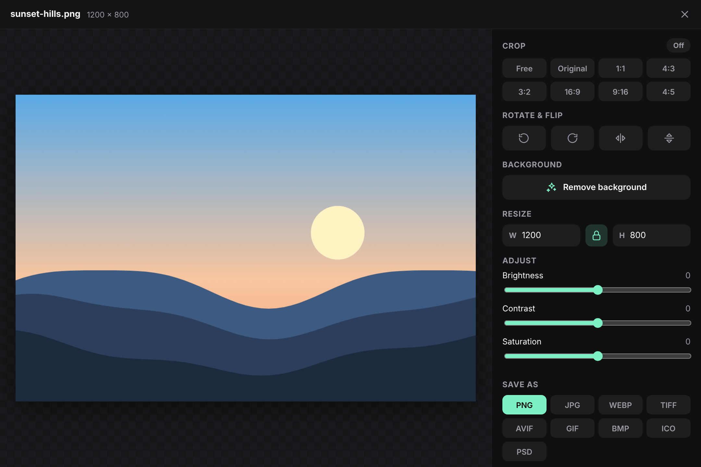</p>

**Remove BG** cuts the subject out of any photo and saves a transparent PNG, using an AI model that runs **entirely on your computer**. Nothing is uploaded. Choose **ISNet** (fast, good for most photos) or **BiRefNet** (best edges for hair and fine detail), and run it on the CPU or GPU, in Settings → General.

The **quick editor** crops (free or 1:1, 4:3, 3:2, 16:9, 9:16, 4:5), rotates, flips, resizes and adjusts brightness, contrast and saturation, then saves a copy next to the original as PNG, JPG, WEBP, AVIF, TIFF, GIF, BMP, ICO or PSD.

### 🎨 Settings & customisation

<p align="center">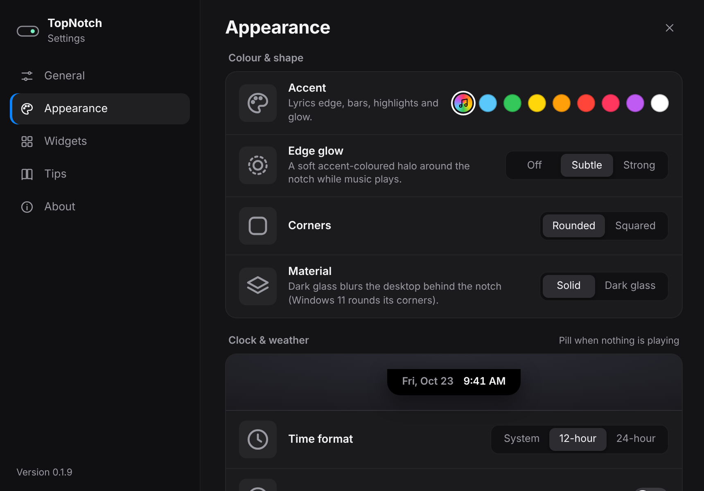</p>

- **Look:** accent colour from the album art or a fixed swatch, edge glow, rounded or squared corners, **Solid** or **Dark glass** (real acrylic blur).
- **Behaviour:** which display, notch size, expand on hover or on click, keep open, lock position, hide behind maximised windows, launch at sign-in.
- **Clock & weather:** 12/24-hour, seconds, date style, °C/°F, your city or automatic.
- **Widgets:** turn every feature on or off on its own.
- **Updates:** built-in update check and one-click install.

---

## 🖥 Windows vs macOS

| Feature | Windows 10 / 11 | macOS (Apple Silicon) |
| --- | :---: | :---: |
| Now playing, synced lyrics, media controls | ✅ | ✅ ¹ |
| Volume & brightness pop-up, scroll to change | ✅ | ✅ |
| Per-app volume mixer | ✅ | — |
| Bluetooth devices & battery | ✅ | ✅ |
| Clipboard history, focus timer, file shelf | ✅ | ✅ |
| CPU / GPU / RAM / network stats | ✅ | ✅ |
| CPU & GPU temperature | ✅ (CPU via optional add-on) | ✅ |
| File wheel converter & AI background removal | ✅ Alt+click | ✅ Option+click |
| Hide behind maximised windows | ✅ | — |
| Updates | Silent install | Downloads and opens the new DMG |

<sub>¹ macOS 15.4+ blocks apps from reading Now Playing directly, so TopNotch uses the open-source <a href="https://github.com/ungive/mediaremote-adapter">mediaremote-adapter</a>.</sub>

### CPU temperature (optional, Windows)

Windows doesn't give apps the CPU temperature. In **Settings → General → Sensors**, *Download & enable* fetches [LibreHardwareMonitor](https://github.com/LibreHardwareMonitor/LibreHardwareMonitor) (MPL-2.0) from its official release and starts it as administrator; Windows asks for permission. Its web server is bound to `127.0.0.1` only. *Start sensors at sign-in* adds a scheduled task so you aren't prompted every time.

---

## ❓ FAQ

<details open>
<summary><b>Is there a Dynamic Island for Windows?</b></summary>

<br />

Yes. TopNotch brings an iPhone-style Dynamic Island to Windows 10 and Windows 11. It sits at the top of the screen, shows music with synced lyrics, live activities like volume, Bluetooth and timers, and opens into a panel with controls when you hover it. It's free and open source.

</details>

<details>
<summary><b>Is TopNotch free?</b></summary>

<br />

Yes. TopNotch is free and open source under the [MIT license](LICENSE). There are no ads, accounts or paid tiers.

</details>

<details>
<summary><b>Is there a notch app for Mac like NotchNook or Boring Notch?</b></summary>

<br />

TopNotch runs on macOS (Apple Silicon, macOS 12 or later) as a free, open-source notch app. It turns the MacBook notch area into a live music player with synced lyrics, plus Bluetooth, clipboard history, a focus timer, system stats, a file shelf and an Option+click file converter.

</details>

<details>
<summary><b>How do I show Spotify lyrics on my desktop?</b></summary>

<br />

Install TopNotch and play a song in Spotify (desktop app or web player). The current lyric line appears in the pill at the top of the screen, filling word by word in time with the song. Hover the pill and open the **Music** tab for the full scrolling lyrics; click any line to jump to it. It works the same with Apple Music, YouTube in a browser and other players.

</details>

<details>
<summary><b>Which music apps does TopNotch work with?</b></summary>

<br />

Any app that reports to the system's media controls, such as Spotify, Apple Music, Tidal, and browsers like Chrome, Edge, Brave and Firefox playing YouTube, YouTube Music or SoundCloud.

</details>

<details>
<summary><b>How do I convert a file or remove a background with TopNotch?</b></summary>

<br />

Hold **Alt** (Windows) or **Option** (Mac) and click the file in File Explorer, Finder or on the desktop. A wheel opens around it: pick a format to convert, or **Remove BG** for a transparent PNG. The new file is saved next to the original, which is never changed.

</details>

<details>
<summary><b>Does the AI background remover upload my photos?</b></summary>

<br />

No. Background removal runs on your own CPU or GPU with a downloaded model (ISNet or BiRefNet). Your images never leave your computer.

</details>

<details>
<summary><b>Does TopNotch slow down my PC?</b></summary>

<br />

It's designed to stay light: system stats and the mixer only update while their tab is open. You can also switch off any feature you don't use in Settings → Widgets.

</details>

<details>
<summary><b>How do I uninstall TopNotch?</b></summary>

<br />

On Windows, use **Settings → Apps → Installed apps → TopNotch → Uninstall** (or just delete the portable `.exe`). On macOS, quit TopNotch from its menu bar icon and move it from Applications to the Bin.

</details>

---

## 🔒 Privacy

TopNotch runs locally. The only network requests are listed in [THIRD_PARTY_NOTICES.md](THIRD_PARTY_NOTICES.md#online-services), each tied to a feature you can switch off.

Clipboard history text is saved to `%APPDATA%\topnotch\clipboard.json`. It is encrypted with your account's key store (DPAPI on Windows, the Keychain on macOS), and copies that password managers mark as private are never recorded. You can still turn the history off in Settings → Widgets.

---

## 🛠 Build from source

Built with **Electron**, **React**, **Vite** and **framer-motion**.

```bash
npm install
npm run dev        # Vite dev server + Electron with hot reload
npm start          # production build, then Electron
npm run dist       # Windows installer + portable exe in release/
```

On a Mac: `bash scripts/build-mac-native.sh` (needs Xcode command line tools and CMake), then `npm run dist -- --mac`.

Pushing a tag like `v0.2.0` runs [the build workflow](.github/workflows/release.yml) and attaches the Windows and macOS builds to a GitHub Release.

Before publishing:
- if you fork this, point `repository`, `homepage`, `bugs` and `build.publish` in `package.json` at your repo so the update check and releases use it
- bump `version` in `package.json` for each release

<details>
<summary><b>Refreshing the README screenshots</b></summary>

<br />

The screenshots in `docs/screenshots/` are the real UI rendered in Chromium with made-up sample data (song, lyrics, devices, files), so no personal information ends up in them. To regenerate them after a UI change:

```bash
npx vite                                   # keep running
node scripts/screenshots/capture.cjs       # needs Playwright with Chromium
```

Pass a folder and a comma-separated list of names to redo only some, e.g. `node scripts/screenshots/capture.cjs docs/screenshots panel-music,settings`.

</details>

### Project layout

| Path | What it does |
| --- | --- |
| `electron/main.cjs` | Windows, tray, IPC, services (lyrics, weather, stats, clipboard, shelf, sensors, updates) |
| `electron/system-helper.cs` + `.ps1` | Long-lived helper compiled by Windows PowerShell 5.1 at startup. It handles volume, brightness, seek, timeline, per-app mixer, privacy, network/GPU counters, Bluetooth and the audio meter, speaking JSON lines over stdio. |
| `electron/media-worker.cjs` | Child process reading Windows media sessions |
| `electron/win32.cjs` | koffi calls: media keys, foreground window, acrylic + window region |
| `electron/mac/helper.swift` | macOS helper: volume, brightness, Bluetooth, Finder clicks |
| `electron/convert.cjs` | File wheel conversions |
| `electron/bgremove.cjs` | On-device background removal (ONNX Runtime) |
| `src/Island.jsx` | What the pill shows and how it animates |
| `src/Lyrics.jsx` | Word timing and the lyric animations |
| `src/Wheel.jsx`, `src/Editor.jsx` | File wheel and quick image editor |
| `src/Settings.jsx` | Settings window |

### Known issues

- **Electron install on Node 26:** Electron's postinstall can exit halfway, leaving `node_modules/electron/dist` with only `locales/`. Extract the cached zip yourself:
  ```powershell
  $zip = Get-ChildItem "$env:LOCALAPPDATA\electron\Cache" -Recurse -Filter 'electron-v*-win32-x64.zip' | Select-Object -First 1
  Expand-Archive $zip.FullName node_modules\electron\dist -Force
  Set-Content node_modules\electron\path.txt 'electron.exe' -NoNewline
  ```
- **Local `npm run dist` symlink error:** it may report `Cannot create symbolic link` while unpacking electron-builder's signing tools. Turn on Windows Developer Mode, or build from an administrator terminal. CI isn't affected.
- **Browser positions:** Brave/Chrome report a stale position until something seeks; TopNotch corrects it with the WinRT timeline timestamp.
- **Monitor buttons:** brightness changed with the monitor's own buttons isn't picked up (DDC/CI has no events).
- **Native flyout:** the Windows volume flyout still appears alongside the pop-up.

---

## ⚠️ Disclaimer

**This is a vibe-coded app.** It was built mostly by prompting an AI coding assistant, not written and reviewed line by line, so expect rough edges.

It's provided **as is, without warranty of any kind**. **The developer is not responsible for anything** that happens from using it, including crashes, data loss, damage to your system or hardware, security or privacy issues, or anything else.

Some features run with extra rights or change system settings: volume, brightness, per-app audio, and optionally LibreHardwareMonitor as administrator plus a sign-in scheduled task. **Use it at your own risk.** See the [license](LICENSE) for the full terms.

## 📄 License

[MIT](LICENSE). Third-party components keep their own licenses; see [THIRD_PARTY_NOTICES.md](THIRD_PARTY_NOTICES.md).

<div align="center">
<br />

**If TopNotch makes your desktop better, a ⭐ helps others find it.**

<sub>Keywords: Dynamic Island for Windows · Windows 11 Dynamic Island · notch app for Mac · MacBook notch music player · synced lyrics on desktop · Spotify lyrics overlay · now playing widget · per-app volume mixer · clipboard history · Pomodoro timer · file converter · AI background remover</sub>

</div>
